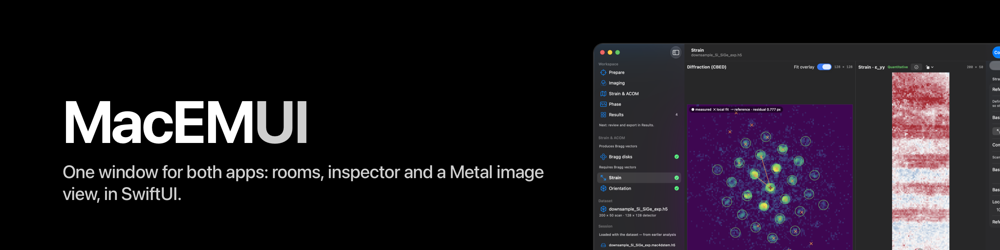

<p align="center"></p>

# MacEMUI

The window shell, controls and Metal image view that mac4DSTEM and macTEM share (suite task 8). An app package, not a
kit: SwiftUI, Metal and a named minimum of AppKit; no numerics (kits stay pure Swift). Working name; the name, the
final home (own repo or this folder) and the tag are Paul's.

| Product | Holds |
|---|---|
| `ShellMetal` | `MetalEngine`, `MetalImageView`, `MetalDisplayTransform`, colormaps and the shader |
| `ShellControls` | `ZoomPan`, `DividerNudge`, `NumericField`, `ProvenanceValueText`, `PaneFooter`, `ScaleBar`, `HistogramChart` |
| `ShellInspector` | the `InspectorRows` kit |
| `ShellLayout` | `LayoutPolicy`, `PanelNavigation`, `WorkspaceRoom`, window, toolbar, sidebar, inspector frame, centre column, `MenuActionRelay`, `ActivityLog`, `SystemMonitor` |

Status: compiled and tested on the Mac since 2026-10-21 (0.2.0 tagged; 0.3.0 on local main, `docs/status.md`). Written in the cloud from mac4DSTEM `8c4c06d` and macTEM `51c944c`; the first Mac session
follows `docs/split-plan.md` in the macEM-suite repo.

```sh
swift build
swift test -c release --parallel    # pure-logic tests; Metal tests need a GPU (the Mac, not hosted CI)
```
